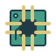
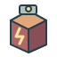
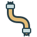

# Mappa di produzione di RocketMan

Questa e' la mappa del prototipo giocabile: cosa raccogliere, cosa trasformare e cosa costruire. Le proposte future sono separate dalle ricette realmente disponibili.

Documento generato dai cataloghi e dalle funzioni di costo del gioco. Non modificare a mano le tabelle: aggiornare le fonti e rigenerare. [Dati strutturati per il futuro computer di bordo](../../design/generated/production-map.json).

## La catena principale

```text
Materie prime -> Componenti -> Strutture, consumabili e potenziamenti
        |             ^
        +-> Semilavorati (facoltativi) --+
```

**Materie prime:** ferro, rame, cristalli, quarzo e cobalto. **Semilavorati:** lingotti di rame e vetro. **Componenti:** strutturali ed elettronici, versatili e impilabili (4 pezzi per unita' di carico). Terra e pietra comuni non entrano nel carico o nelle ricette.

Il laboratorio di bordo e' gia' funzionante e parte senza scorte minerali. Produce componenti; il personaggio li monta sul posto. Non si trasportano cubi di stanze gia' scelte. Le scale sono l'eccezione gratuita e immediata.

## Il primo laboratorio

Raccogli **8 ferro + 3 rame + 1 cristallo**, produci **2 lotti strutturali + 1 elettronico**, ritira **4 componenti strutturali + 2 elettronici** e monta il laboratorio in uno spazio valido di **4 x 3 m**. Lo scanner trova i filoni nascosti e Robbie raccoglie i frammenti.

Dopo il primo laboratorio da campo si sbloccano luci, pompe, ventilatori, fornaci, convertitori e serre, oltre alle ricette avanzate dei due componenti. I consumi della rete si aggiungono all'energia specifica riportata nelle tabelle.

## Raccolta dalla roccia

Ogni blocco di minerale prezioso produce pezzi dello stesso materiale: **1 pezzo nel 65%**, **2 pezzi nel 25%**, **3 pezzi nel 10%** dei casi. I frammenti cadono e rimbalzano; Robbie li raccoglie singolarmente col magnete. Quelli che non entrano nel carico restano al suolo e si conservano nel salvataggio. Terra e pietra non producono carico.

Su Ocra rame e ferro si trovano subito a sinistra della scala della nave; tre blocchi di cristallo sono presenti poco oltre sullo stesso percorso, oltre ai cristalli a destra. Non serve attraversare una falda o raggiungere il sottosuolo profondo per il primo laboratorio.

**Playtest: sacche di gas sospese.** Nei nuovi mondi non c'e' gas naturale, quindi la filiera energetica locale di convertitori, fornaci e serre e' in attesa di alimentazione. Le ricette sotto descrivono i sistemi implementati, non una nuova fonte gratuita di energia. Pompe e valvole acqua usano ancora la rete del laboratorio.

## Semilavorati

| Icona | Operazione | Dove | Ingredienti | Risultato | Tempo base | Energia | Condizioni |
| --- | --- | --- | --- | --- | --- | --- | --- |
|  | Lingotto di rame | Fornace | 2 Rame | 1 Lingotto rame | 12 s | 2.4 Energia locale [kWh] | Fornace collegata a un convertitore gas tramite cavo; ritirare il prodotto. |
|  | Vetro | Fornace | 2 Quarzo | 1 Vetro | 10 s | 2 Energia locale [kWh] | Fornace collegata a un convertitore gas tramite cavo; ritirare il prodotto. |

## Componenti e consumabili

| Icona | Operazione | Dove | Ingredienti | Risultato | Tempo base | Energia | Condizioni |
| --- | --- | --- | --- | --- | --- | --- | --- |
|  | Componenti strutturali | Laboratorio di bordo o da campo | 4 Ferro | 2 Componente strutturale | 2 s | 0.01 Energia nave [kWh] | Disponibile dal laboratorio iniziale della nave. |
|  | Componenti elettronici | Laboratorio di bordo o da campo | 3 Rame + 1 Cristallo | 2 Componente elettronico | 2 s | 0.01 Energia nave [kWh] | Disponibile dal laboratorio iniziale della nave. |
|  | Elettronica da vetro e lingotti | Laboratorio di bordo o da campo | 2 Lingotto rame + 1 Vetro | 4 Componente elettronico | 2 s | 0.01 Energia nave [kWh] | Dopo il primo laboratorio da campo. |
|  | Strutture in lega di cobalto | Laboratorio di bordo o da campo | 2 Ferro + 1 Cobalto | 4 Componente strutturale | 2 s | 0.01 Energia nave [kWh] | Dopo il primo laboratorio da campo. |
|  | Bomba | Laboratorio di bordo o da campo | 1 Componente strutturale + 1 Componente elettronico | 1 Bomba | 2 s | 0.01 Energia nave [kWh] | Scorte bombe: massimo 4. |

## Montaggio delle strutture

| Icona | Operazione | Dove | Ingredienti | Risultato | Tempo base | Energia | Condizioni |
| --- | --- | --- | --- | --- | --- | --- | --- |
|  | Laboratorio | Sul posto | 4 Componente strutturale + 2 Componente elettronico | 1 Laboratorio | 5 s | 0.3 Energia nave [kWh] | 4 x 3 m; componenti nel carico accessibile. Disponibile dall'inizio. |
|  | Luce | Sul posto | 1 Componente elettronico | 1 Luce | 2.5 s | 0.05 Energia nave [kWh] | 1 x 1 m; componenti nel carico accessibile. Sbloccato dopo il primo laboratorio da campo. |
|  | Pompa acqua | Sul posto | 2 Componente strutturale + 2 Componente elettronico | 1 Pompa acqua | 4 s | 0.32 Energia nave [kWh] | 2 x 2 m; componenti nel carico accessibile. Sbloccato dopo il primo laboratorio da campo. |
|  | Ventilatore gas | Sul posto | 1 Componente strutturale + 2 Componente elettronico | 1 Ventilatore gas | 4 s | 0.2 Energia nave [kWh] | 2 x 2 m; componenti nel carico accessibile. Sbloccato dopo il primo laboratorio da campo. |
|  | Fornace | Sul posto | 3 Componente strutturale + 1 Componente elettronico | 1 Fornace | 5 s | 0.3 Energia nave [kWh] | 3 x 2 m; componenti nel carico accessibile. Sbloccato dopo il primo laboratorio da campo. |
|  | Convertitore gas | Sul posto | 2 Componente strutturale + 2 Componente elettronico | 1 Convertitore gas | 4 s | 0.24 Energia nave [kWh] | 2 x 2 m; componenti nel carico accessibile. Sbloccato dopo il primo laboratorio da campo. |
|  | Serra | Sul posto | 4 Componente strutturale + 2 Componente elettronico | 1 Serra | 6 s | 0.36 Energia nave [kWh] | 4 x 3 m; componenti nel carico accessibile. Sbloccato dopo il primo laboratorio da campo. |

## Scale tubi e cavi

| Icona | Operazione | Dove | Ingredienti | Risultato | Tempo base | Energia | Condizioni |
| --- | --- | --- | --- | --- | --- | --- | --- |
|  | Posa scala | Sul posto | Nessuno | 1 Scala | 0 s | Nessuno | Posa e rimozione immediate e gratuite; restano i vincoli geometrici. |
|  | Tubo acqua | Sul posto | 1 Componente strutturale | 1 Tubo acqua | 0 s | Nessuno | Costo per segmento di 1 m; posa immediata, non una lavorazione in laboratorio. |
|  | Tubo gas | Sul posto | 1 Componente strutturale | 1 Tubo gas | 0 s | Nessuno | Costo per segmento di 1 m; posa immediata, non una lavorazione in laboratorio. |
|  | Cavo energia | Sul posto | 1 Componente elettronico | 1 Cavo energia | 0 s | Nessuno | Costo per segmento di 1 m; posa immediata, non una lavorazione in laboratorio. |
|  | Monta presa stagna | Faccia di una roccia | 2 Componente strutturale + 1 Componente elettronico | 1 Presa stagna | 0 s | Nessuno | Dopo il primo laboratorio; occupa 1 x 1 m libero. Perfora un solo blocco con il tool compatibile senza rimuoverlo. Apertura manuale; scollegare il tubo la chiude. |
|  | Configura terminale acqua | Su tubo acqua gia' posato | Nessuno | 1 Terminale di scarico | 0 s | Nessuno | Terminale chiuso inizialmente; orientabile verso una cella libera. Clic destro: scarico oppure aspirazione da una vasca. Cambiare ruolo lo richiude. Scaricare versa acqua fisica, che puo' traboccare. Non e' un nuovo macchinario. |

## Acqua gas ed energia

| Icona | Operazione | Dove | Ingredienti | Risultato | Tempo base | Energia | Condizioni |
| --- | --- | --- | --- | --- | --- | --- | --- |
|  | Converti gas in energia locale | Convertitore gas | 1 Gas | 12 Energia locale [kWh] | 25 s | Nessuno | Processo continuo: gas da una falda collegata con tubi; accumulo massimo 12 kWh. Non ricarica automaticamente la nave. |
|  | Recupera acqua | Pompa acqua | 1 Acqua | 1 Acqua nel serbatoio | 1.429 s | 0.043 Energia nave [kWh] | Presa stagna perforata e aperta, tubo fino all'ingresso; uscita separata verso serra o scarico. Buffer 8 u; aspirazione e sollevamento entro 6 m dalla pompa. Nessun drenaggio per raggio. |
|  | Trasferisci acqua per gravita' | Presa e scarico collegati | 1 Acqua | 1 Acqua | 2.857 s | Nessuno | Acqua spostata, non creata. Percorso sotto il livello della presa e scarico piu' basso. Cella ricevente piena o contaminata ferma il trasferimento. |
|  | Rimuovi gas pericoloso | Ventilatore gas | 1 Gas | Nessuno | 2.857 s | 0.057 Energia nave [kWh] | Rimuove il gas dall'ambiente: non produce carburante o energia. |

## Coltivazione

| Icona | Operazione | Dove | Ingredienti | Risultato | Tempo base | Energia | Condizioni |
| --- | --- | --- | --- | --- | --- | --- | --- |
|  | Patata | Serra | 1 Semi di patata + 2 Acqua nel serbatoio | 3 Patata + 2 Semi di patata | 45 s | 0.9 Energia locale [kWh] | Nave: 3 semi di patata iniziali. |
|  | Tubero ocra | Serra | 1 Semi di tubero ocra + 2.5 Acqua nel serbatoio | 3 Tubero ocra + 2 Semi di tubero ocra | 50 s | 1 Energia locale [kWh] | Semi trovati nelle capsule dei pianeti; acqua da pompa e energia locale via cavi. |
|  | Verdura viridia | Serra | 1 Semi di verdura viridia + 3 Acqua nel serbatoio | 3 Verdura viridia + 2 Semi di verdura viridia | 40 s | 0.8 Energia locale [kWh] | Semi trovati nelle capsule dei pianeti; acqua da pompa e energia locale via cavi. |
|  | Bacca brina | Serra | 1 Semi di bacca brina + 1.5 Acqua nel serbatoio | 3 Bacca brina + 2 Semi di bacca brina | 60 s | 1.2 Energia locale [kWh] | Semi trovati nelle capsule dei pianeti; acqua da pompa e energia locale via cavi. |

## Potenziamenti

| Icona | Operazione | Dove | Ingredienti | Risultato | Tempo base | Energia | Condizioni |
| --- | --- | --- | --- | --- | --- | --- | --- |
|  | Scafo 1 > 2 | Officina della nave | 4 Componente strutturale + 2 Componente elettronico | 1 Scafo L2 | 0 s | Nessuno | +40 integrita massima per livello |
|  | Scafo 2 > 3 | Officina della nave | 8 Componente strutturale + 4 Componente elettronico | 1 Scafo L3 | 0 s | Nessuno | +40 integrita massima per livello |
|  | Propulsori 1 > 2 | Officina della nave | 3 Componente strutturale + 4 Componente elettronico | 1 Propulsori L2 | 0 s | Nessuno | Riduce del 12% il costo delle rotte per livello |
|  | Propulsori 2 > 3 | Officina della nave | 6 Componente strutturale + 8 Componente elettronico | 1 Propulsori L3 | 0 s | Nessuno | Riduce del 12% il costo delle rotte per livello |
|  | Stiva 1 > 2 | Officina della nave | 3 Componente strutturale + 1 Componente elettronico | 1 Stiva L2 | 0 s | Nessuno | +80 unita di carico per livello |
|  | Stiva 2 > 3 | Officina della nave | 6 Componente strutturale + 2 Componente elettronico | 1 Stiva L3 | 0 s | Nessuno | +80 unita di carico per livello |
|  | Accumulatori 1 > 2 | Officina della nave | 1 Componente strutturale + 4 Componente elettronico | 1 Accumulatori L2 | 0 s | Nessuno | +40 kWh di capacita per livello |
|  | Accumulatori 2 > 3 | Officina della nave | 2 Componente strutturale + 8 Componente elettronico | 1 Accumulatori L3 | 0 s | Nessuno | +40 kWh di capacita per livello |
|  | Banco strumenti 1 > 2 | Officina della nave | 2 Componente strutturale + 3 Componente elettronico | 1 Banco strumenti L2 | 0 s | Nessuno | +1 potenza per livello. Sblocca Risonatore (II) e Plasma (III). Richiede il primo laboratorio da campo. |
|  | Banco strumenti 2 > 3 | Officina della nave | 4 Componente strutturale + 6 Componente elettronico | 1 Banco strumenti L3 | 0 s | Nessuno | +1 potenza per livello. Sblocca Risonatore (II) e Plasma (III). Richiede il primo laboratorio da campo. |
|  | Carrelli 1 > 2 | Officina della nave | 3 Componente strutturale + 1 Componente elettronico | 1 Carrelli L2 | 0 s | Nessuno | Riduce l'usura da atterraggio |
|  | Carrelli 2 > 3 | Officina della nave | 6 Componente strutturale + 2 Componente elettronico | 1 Carrelli L3 | 0 s | Nessuno | Riduce l'usura da atterraggio |
|  | Supporto vitale 1 > 2 | Officina della nave | 2 Componente strutturale + 4 Componente elettronico | 1 Supporto vitale L2 | 0 s | Nessuno | +60 min di riserva nominale e +1 posto equipaggio |
|  | Supporto vitale 2 > 3 | Officina della nave | 4 Componente strutturale + 8 Componente elettronico | 1 Supporto vitale L3 | 0 s | Nessuno | +60 min di riserva nominale e +1 posto equipaggio |
|  | Drone assistente 1 > 2 | Officina della nave | 4 Componente strutturale + 4 Componente elettronico | 1 Drone assistente L2 | 0 s | Nessuno | +8 carico, +0.35 m magnete e +5 m rete impianti per livello; seguito senza limite Richiede il primo laboratorio da campo. |
|  | Drone assistente 2 > 3 | Officina della nave | 8 Componente strutturale + 8 Componente elettronico | 1 Drone assistente L3 | 0 s | Nessuno | +8 carico, +0.35 m magnete e +5 m rete impianti per livello; seguito senza limite Richiede il primo laboratorio da campo. |
|  | Laboratorio 1 > 2 | Laboratorio di bordo o da campo | 4 Componente strutturale + 2 Componente elettronico | 1 Laboratorio L2 | 0 s | Nessuno | Potenzia la singola postazione. Il laboratorio di bordo richiede prima il primo laboratorio da campo. |
|  | Laboratorio 2 > 3 | Laboratorio di bordo o da campo | 8 Componente strutturale + 4 Componente elettronico | 1 Laboratorio L3 | 0 s | Nessuno | Potenzia la singola postazione. Il laboratorio di bordo richiede prima il primo laboratorio da campo. |

## Riparazioni

| Icona | Operazione | Dove | Ingredienti | Risultato | Tempo base | Energia | Condizioni |
| --- | --- | --- | --- | --- | --- | --- | --- |
|  | Ripara Laboratorio | Installazione danneggiata | 2 Componente strutturale + 1 Componente elettronico | 1 Ripristino: Laboratorio | 0 s | Nessuno | Costo: meta' del montaggio, arrotondata per eccesso per ciascun componente. |
|  | Ripara Luce | Installazione danneggiata | 1 Componente elettronico | 1 Ripristino: Luce | 0 s | Nessuno | Costo: meta' del montaggio, arrotondata per eccesso per ciascun componente. |
|  | Ripara Pompa acqua | Installazione danneggiata | 1 Componente strutturale + 1 Componente elettronico | 1 Ripristino: Pompa acqua | 0 s | Nessuno | Costo: meta' del montaggio, arrotondata per eccesso per ciascun componente. |
|  | Ripara Ventilatore gas | Installazione danneggiata | 1 Componente strutturale + 1 Componente elettronico | 1 Ripristino: Ventilatore gas | 0 s | Nessuno | Costo: meta' del montaggio, arrotondata per eccesso per ciascun componente. |
|  | Ripara Fornace | Installazione danneggiata | 2 Componente strutturale + 1 Componente elettronico | 1 Ripristino: Fornace | 0 s | Nessuno | Costo: meta' del montaggio, arrotondata per eccesso per ciascun componente. |
|  | Ripara Convertitore gas | Installazione danneggiata | 1 Componente strutturale + 1 Componente elettronico | 1 Ripristino: Convertitore gas | 0 s | Nessuno | Costo: meta' del montaggio, arrotondata per eccesso per ciascun componente. |
|  | Ripara Serra | Installazione danneggiata | 2 Componente strutturale + 1 Componente elettronico | 1 Ripristino: Serra | 0 s | Nessuno | Costo: meta' del montaggio, arrotondata per eccesso per ciascun componente. |
|  | Ripara scafo | Officina della nave | 2 Componente strutturale + 1 Componente elettronico | 25 Integrita' scafo | 0 s | Nessuno | Il recupero e' limitato dall'integrita' massima. |
|  | Ripara officina di bordo | Officina danneggiata | 3 Componente strutturale + 1 Componente elettronico | 1 Officina di bordo riparata | 0 s | Nessuno |  |

## Servizi provvisori della nave

| Icona | Operazione | Dove | Ingredienti | Risultato | Tempo base | Energia | Condizioni |
| --- | --- | --- | --- | --- | --- | --- | --- |
|  | Rifornisci nave | Officina della nave | 1 Componente elettronico | 20 Carburante nave | 0 s | Nessuno | Ricetta provvisoria del prototipo: il petrolio non viene ancora usato per il carburante. |
|  | Ricarica batteria nave | Officina della nave | Nessuno | 15 Energia nave [kWh] | 0 s | Nessuno | Servizio provvisorio senza ingredienti; non e' ancora una filiera energetica definitiva. |

## A cosa serve ogni materiale

Indice inverso: le tabelle sopra contengono i costi; questo elenco indica dove viene utilizzata ogni risorsa.

-  **Rame:** Lingotto di rame; Componenti elettronici.
-  **Energia locale [kWh]:** Lingotto di rame; Vetro; Patata; Tubero ocra; Verdura viridia; Bacca brina.
-  **Quarzo:** Vetro.
-  **Ferro:** Componenti strutturali; Strutture in lega di cobalto.
-  **Energia nave [kWh]:** Componenti strutturali; Componenti elettronici; Elettronica da vetro e lingotti; Strutture in lega di cobalto; Bomba; Laboratorio; Luce; Pompa acqua; Ventilatore gas; Fornace; Convertitore gas; Serra; Recupera acqua; Rimuovi gas pericoloso.
-  **Cristallo:** Componenti elettronici.
-  **Lingotto rame:** Elettronica da vetro e lingotti.
-  **Vetro:** Elettronica da vetro e lingotti.
-  **Cobalto:** Strutture in lega di cobalto.
-  **Componente strutturale:** Bomba; Laboratorio; Ripara Laboratorio; Pompa acqua; Ripara Pompa acqua; Ventilatore gas; Ripara Ventilatore gas; Fornace; Ripara Fornace; Convertitore gas; Ripara Convertitore gas; Serra; Ripara Serra; Tubo acqua; Tubo gas; Monta presa stagna; Scafo 1 > 2; Scafo 2 > 3; Propulsori 1 > 2; Propulsori 2 > 3; Stiva 1 > 2; Stiva 2 > 3; Accumulatori 1 > 2; Accumulatori 2 > 3; Banco strumenti 1 > 2; Banco strumenti 2 > 3; Carrelli 1 > 2; Carrelli 2 > 3; Supporto vitale 1 > 2; Supporto vitale 2 > 3; Drone assistente 1 > 2; Drone assistente 2 > 3; Laboratorio 1 > 2; Laboratorio 2 > 3; Ripara scafo; Ripara officina di bordo.
-  **Componente elettronico:** Bomba; Laboratorio; Ripara Laboratorio; Luce; Ripara Luce; Pompa acqua; Ripara Pompa acqua; Ventilatore gas; Ripara Ventilatore gas; Fornace; Ripara Fornace; Convertitore gas; Ripara Convertitore gas; Serra; Ripara Serra; Cavo energia; Monta presa stagna; Scafo 1 > 2; Scafo 2 > 3; Propulsori 1 > 2; Propulsori 2 > 3; Stiva 1 > 2; Stiva 2 > 3; Accumulatori 1 > 2; Accumulatori 2 > 3; Banco strumenti 1 > 2; Banco strumenti 2 > 3; Carrelli 1 > 2; Carrelli 2 > 3; Supporto vitale 1 > 2; Supporto vitale 2 > 3; Drone assistente 1 > 2; Drone assistente 2 > 3; Laboratorio 1 > 2; Laboratorio 2 > 3; Ripara scafo; Rifornisci nave; Ripara officina di bordo.
-  **Gas:** Converti gas in energia locale; Rimuovi gas pericoloso.
-  **Acqua:** Recupera acqua; Trasferisci acqua per gravita'.
-  **Semi di patata:** Patata.
-  **Acqua nel serbatoio:** Patata; Tubero ocra; Verdura viridia; Bacca brina.
-  **Semi di tubero ocra:** Tubero ocra.
-  **Semi di verdura viridia:** Verdura viridia.
-  **Semi di bacca brina:** Bacca brina.

## Vincoli importanti

- Il tempo dei lotti e' riferito a un laboratorio L1; i livelli superiori accelerano la produzione. Ingredienti ed energia del lotto si pagano all'avvio; output e avanzamento non si perdono chiudendo il menu.
- Il montaggio usa solo componenti nel carico accessibile, non scorte remote della nave. Un progetto senza componenti resta in attesa e non fornisce servizi.
- La fornace usa energia locale del convertitore, non direttamente la batteria della nave. La serra richiede anche acqua conservata dalla pompa: servono collegamenti reali.
- Il laboratorio e i dispositivi alimentati dalla nave continuano a consumare durante l'uso: l'energia di montaggio non e' il loro intero costo di vita.
- Le riparazioni elencate sono riparazioni di installazioni/scafo. La manutenzione di tuta e Robbie e il riposo non sono nuove ricette di costruzione.

## Da progettare o completare

- **Fabbricazione dei singoli tool:** Ricette e costi da definire. Pulse, Scanner e Jetpack sono iniziali; Risonatore e Plasma si ottengono dal Banco strumenti.
- **Potenziamenti acquistabili dello scanner:** Proposta approvata: raggi 4/5/6/7 m e tracce solo sull'onda / 3 / 7 / 12 s. Acquisto e nuova curva non ancora implementati: oggi la persistenza e' 2 + 0.7 s per livello.
- **Lavorazione del petrolio:** Petrolio e acido sono pericoli fisici, non ingredienti di ricette attuali. Nessun costo futuro inventato.
- **Enciclopedia del computer di bordo:** Usare gli stessi dati generati per cercare ingredienti, prodotti, stazioni, sblocchi e impieghi. La schermata nel gioco non esiste ancora.
- **Serbatoi della nave e bocchettoni:** Serbatoi inizialmente vuoti e separati per acqua/gas/altri fluidi; carico e scarico fisici per trasportare risorse fra pianeti. Non implementati in questa tranche.
- **Pavimenti e volumi costruibili:** Possibilita' di creare appoggi e passaggi dopo scavi estesi; decisioni rinviate dal giocatore.
- **Filtri per purificare l'acqua:** Fondamentali per le coltivazioni: le serre richiederanno acqua adatta all'irrigazione, non soltanto una quantita' disponibile; l'acqua contaminata dovra' essere filtrata. Modulo separato dalla pompa e collegato ai tubi prima dell'utilizzo o dello stoccaggio. Contaminanti, soglie di qualita', ricette, consumi e manutenzione da definire; nessuna purificazione attiva nel runtime attuale.

## Come tenere aggiornata la mappa

```powershell
godot --headless --path . -s res://tools/design/build-production-map.gd
godot --headless --path . -s res://tools/design/build-production-map.gd -- --check
```

Il comando genera questo documento e il JSON della mappa. `--check` fallisce se uno dei due e' assente o non aggiornato. Le fonti sono `prototype_components.json`, `prototype_industry.json`, i cataloghi dei moduli e i metodi di costo di strutture, nave, condotti e riparazioni. Le proposte e le note editoriali si aggiornano nel generatore.

**Computer di bordo, prossimo passo:** ricerca per nome; viste 'come si produce' e 'a cosa serve'; catena degli ingredienti; stazioni richieste; materiali posseduti/mancanti. Il documento di sviluppo mostra tutto, ma la futura vista del giocatore dovra' distinguere ricette note, sbloccate e ancora da scoprire.
